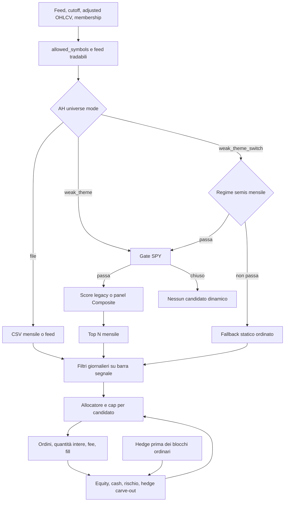

# Dipendenze, interazioni e verifiche — 22 ottobre 2026

Legenda: **M** dipendenza imposta dal codice; **C** confronto controllato già misurato nel setup indicato; **A** associazione osservata, senza attribuzione causale; **H** ipotesi da verificare. Un effetto di una riga storica non è un effetto medio trasferibile a ogni epoca o configurazione. Il prodotto cartesiano di tutti i parametri non è giustificato.

## Flusso e dipendenze meccaniche

SPY chiuso nel ramo dinamico non produce fallback statico: il fallback dipende dal regime semis, non dall'esito del gate SPY. Composite senza panel o con pesi vuoti può rispettivamente vuotare o rendere alfabetico il ranking: sono condizioni d'integrità, non segnali economici di cash.

## Matrice delle interazioni decisive

| Interazione | Tipo / stato | Evidenza e limiti | Verifica utile prima di decidere |
|---|---|---|---|
| Ranking/universo × filtri range/ADV/gap | **M+C**, non assente | Filtri scartano il ranking alto; [S08](study_register.md) confronta due ranking a filtri matched. Composito relativo da−11.71% con tutti a+6.94% senza, +21.77% con solo gap. Non singolo effetto dominante né pieno fattoriale, storico già scelto. | Nel setup freeze attuale confronto dei due ranking con i medesimi filtri/lag/sizing/fee; riuso precedenti per evitare sweep indiscriminato. Separare minADV da capADV. |
| Ranking × mode/switch/statico/SPY | **M**, più **A** storica | Flat modifica solo ramo dinamico; fallback statico comune può dominare alcuni periodi. Gate solo dinamico; SPY assente bypass. Confronti profili possono differire anche top50/60 e gap. | Quote sedute/dollari per ramo, supporto comune ed effettivo; nessun merito a composite nei mesi in cui opera statico. Tenere stessi simboli/fattoreSPY. |
| Panel × cutoff × vintage × refresh | **M**, audit tecnico corrente | CSV label mese usa prima seduta globale; shift1/closedleft esclude seduta stessa. [Audit](../../../bt-strategy-test/strategy-selection/study_20261022/inventory/flat_panel_audit.json):Oct2026 solo storia≤Sep30 e42celle invarianti a future perturbazioni; intermedi riproducono tutte righe. Vintage storico non certificato. | Congelare panel e data pubblicazione; lastmonth/completeness. Scheduler presenza non è prova refresh avvenuto prima prima decisione mensile. |
| Hedge × cooldown/overlay | **M+C parziale** | Hedge prima di cooldown/risk; può aprire quando ordinari fermi. Carve-out solo se hedge effettivamente aperto. [S09](study_register.md) confronti EMA/cooldown esistono, con correzioni feedSQQQ e auction e sizing fissi/composti. | Se hedge incluso, almeno2×2 matched on/off cooldown e hedge, usando stesso signal lag e fee, distinguendo disinvestimento ordinario dal guadagno hedge. Non adottare beneficio vecchio65/150 per default. |
| CUSUM × warmup/stato × orizzonte | **M+C**, negativo | [S04](study_register.md): segmenti isolati davano esiti favorevoli, continuo/deployment no. Ricominciare stato o cambiare calibrazione cambia policy. | Preservare ultimo esito negativo; non riproporre h/window sweep come nuovo monitor senza meccanismo e ipotesi diversi. Nessun rientro da serie reale interrotta senza shadow osservabile. |
| Throttle × modalità esecutiva | **M**, incompatibilità di osservazione | Uscite native notificano rendimento alla stessa istanza; MOO esterno paper/live no. Parametri identici non producono stesso overlay. | Confrontare fonte/ricezione uscite; non trasferire PnL backtest throttle al live senza percorso osservabile verificato. |
| Gap × cooldown | **M+C** | Trattano entrambi episodi overnight ma su grain diversi (singolo ticker vs media universo). Vecchi test con entrambi OFF miglioravano meno della somma naive [S09](study_register.md); sum of equity compounded non è coefficiente interazione statistica. | Rerun matched2×2 solo se decisionale, usando metrica appaiata giornaliera/esposizione e capitale coerente. NON sommare Δcapitali terminali. |
| CapADV × capitale × breadth × pool mensile | **M+C planner +A economica** | Waterfall espande floor→ceiling per1x, aggiungendo nomi meno alti. S14E1 replica6544decisioni, NAVfis200k riduce breadth media11.5223→3.0032 nel primario, nessun nuovo fill. Cap/materialità16.6261% non identifica equity corretta. | Scenari capitale limitati e motivati, log richiesta/cap/fill/rankmarginale/cashidle; stesso universo, fee e stato. Certificare unità o conclusioni condizionate. |
| max_notional × ceiling × capitale | **M+C storico** | Cap10k×50slot capacità massima500k (AH senza leva e senza altre restrizioni); quote e ADV possono ridurla ulteriormente. S10riduce rischio e CAGR. Non è fill-level guarantee. | Esplicitare capacità teorica upper bound e superamenti notional al fill; costo/tempo recupero a esposizioni matched. |
| Sizing × compounding × fee | **M+C** | Fixednotional e percentuale cambiano percorso equity, capbinding, breadth e fee assolute; [S09/S10](study_register.md). S13stress nativo cambia anche allocazioni, forte sensibilitàcosti. | Separare conto continuo compound e nozionale fisso; non confrontare terminalmultiples fra capitali. Applicare costi nel broker, non sottrarre fee a posteriori. |
| Leva strategia × leva broker × hedge | **M** | max_exposure2 richiede broker cap coerente; RMA waterfall cash ceiling non abilita margine. Hedge SQQQ è già strumento leveraged. Profili challenger2x eAH1x differiscono rischio. | Confronto nativo più normalizzazione rischio/esposizione; registrare target/effettiva e leverage underlying, non solo max_exposure. |
| RMA periodi × timeframe × warmup | **M**, verifica tecnica | Period180/30 sono barre; daily setup warmup359; liquiditySMA20 inizializzata anche cap off. Cambiare weekly o start date cambia informazione. Adjusted resampler corretto necessario. | Stessi feed/warmup; verificare indicatori finiti e prima barra operabile. Nessuna deduzione da nomeweekly. |
| RMA max_volatility × uscite | **M**, **H** beneficio correzione isolata | Vol filtro applicato prima di rlist/dlist: detenuto molto volatile può perdere segnale uscita. Non basta rimuovere esenzione ranking. S15C01nullo non testa eliminazione volatilità dalle uscite. | Ipotesi distinta, non bugfix automatico della candidata. Eventuale nuova variante con native fill/costi e review protocollo. |
| RMA min_concurrent × uscite selezionati × trailing | **M+C** | Ampiezza determina selezionati esenti da uscite native. Aumentarla cambia sia diversificazione sia gestione uscite;9challenger S15. Ampiezze5/10menoDD ma gatefallito. | Non attribuire DDinferiore alla sola diversificazione statistica. Trattare effetto della policy intera o disegno che separi meccanismi. |
| RMA cap allocator × reserve × amount × voltarget | **M** | Legacy percentcap redistribuisce, waterfall no shortfall ordinario; fixedamount non redistribuisce sopra amount; maxamount può espandere; ordinary reserve20% non reserveparam. | Registrare policy effettiva e budget; per strategie diverse stesso nomepolicy non implica stessa allocazione. |
| RMA regime × benchmark | **M+C** | Regime solo se benchmark presente; `regime_exit` può chiudere. S15QQQregression150nativo falliscegate; non è SMA200studiodescrittivo. | Benchmark separato universo negoziato; hash/date/feed stessi. Nessun trasferimento di associazione SMA200 a filtro RMA150. |
| Segnale lag × asta × data del run | **M+C tecnico** | Lag0vedeOHLCdelclose di fill; lag1ex-ante. Live ultimo feedbarcompleto può richiedere lag0effettivo su barra troncata; decision_date_override emula data senzaAlpaca. | Confrontare information set reali, non numero lag isolato. Registrare barra segnale/data decisione/fill; t−1 è scelta economica. |
| Recovery OPG × posizioni × entryslots | **M**, tecnico operativo | Fullreentry pendingfallback e holdeligible sono distinti; secondo prevale. `hold_confirmed_positions` cambia orizzonte economico invece di sola recovery. | Tenere recovery spenta nei confronti puramente storici salvo replicaesplicita; prove operative specifiche separate da scelta alpha. |
| AH × Composite × RMA → diversificazione/switch | **H**, confronto corrente necessario | AH/Composite condividono esecuzione/rischi/listastatica e possono avere tailcomune. RMA holding diverso. Rotazione titoli negativa S13 non prova impossibilità switchfra3, ma neanche lo valida. | Confronti allineati su calendario, stessa convenzione dati/costi/capitale; fixedweights/cash/reduction come controlli. Nuova policy causale con stato/filldelay/costocambio; niente oracle operativo. |
| Peggioramento dopo luglio × parametri/dati | **A/H**, non rottura provata | Storico recente già osservato; precedente report giugno/luglio cambia percentile con2/5giorni. Profili/lag/feed/fees possono cambiare spiegazione. | Tre livelli: integrità, esecuzione vsreplay, economia replay. Analisi epoche/change-point retrospettiva e incertezza dipendente; nessuna attribuzione crowding senza dati identificanti. |

## Riduzione del disegno sperimentale

Le dipendenze meccaniche possono essere verificate senza ottimizzazione: params risolti, branch scelto, panelmese, timestampbar, floor/ceiling, budget/cap e disponibilità benchmark. Le verifiche tecniche non contano come evidenza di alpha.

Gli esperimenti economici ulteriori devono essere pochi e selezionati dal Research Director: un confronto matched dei ranking può chiarire se la differenza profili è davvero Composite; piccoli2×2 possono isolare gap/cooldown oppure hedge/cooldown soltanto se l'effetto resta rilevante dopo le evidenze negative. Capitale e costi sono scenari, non iperparametri da massimizzare. Nessuna soglia viene scelta in questo documento e nessun nuovo sweep è stato avviato.

Resta da verificare indipendentemente il join tra questa matrice, i valori dei profili sanitizzati e i manifest dei run. Le associazioni fra parametri nei run Watchtower non sono un esperimento randomizzato; non stimano effetti dei parametri senza contrasto controllato.
