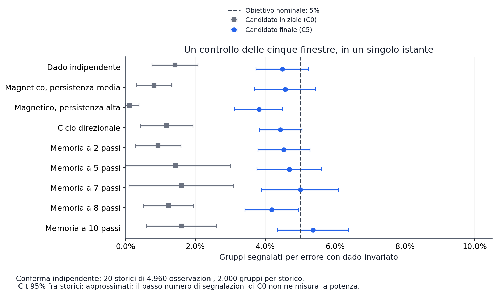
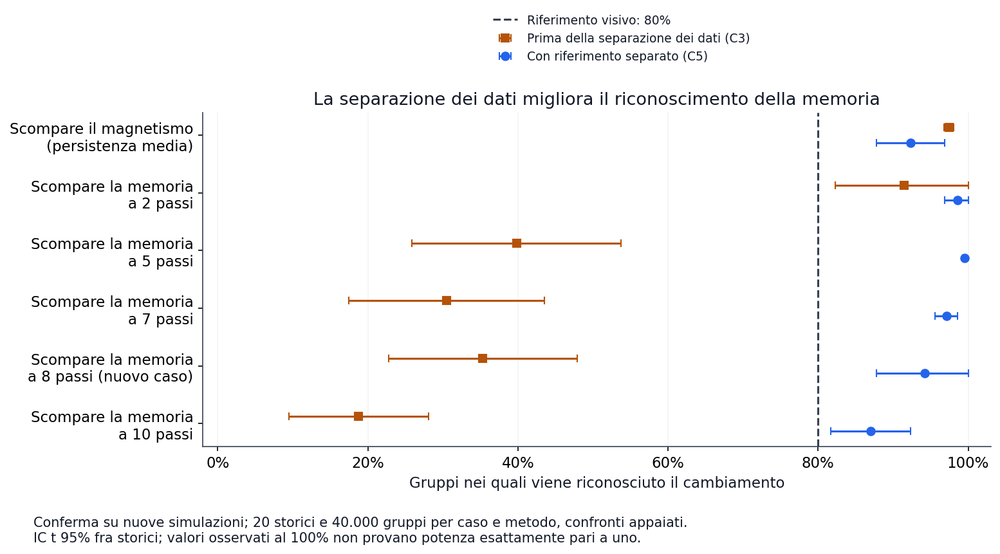
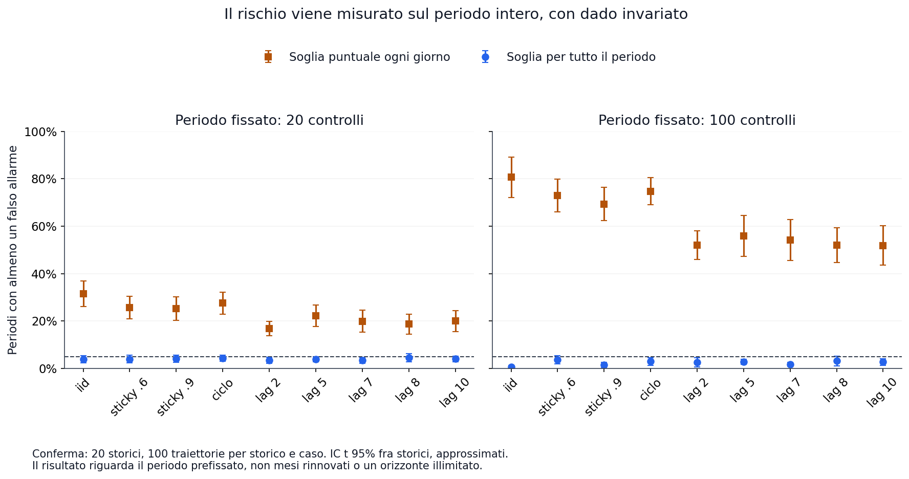
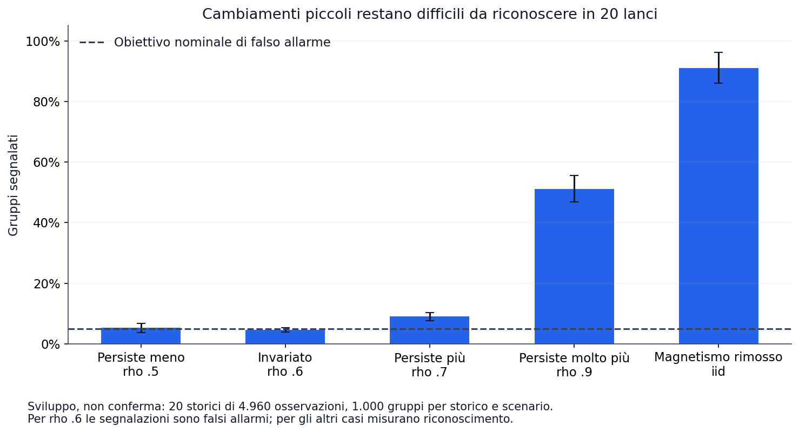

# Candidato rivisto: cosa misura, cosa riconosce e che cosa proporre

Studio statistico del 24 ottobre 2026. **Solo simulazioni dichiarate del dado:
nessuna modifica all'applicazione e nessun risultato di strategie reali.**

## La decisione proposta

La versione finale supera i criteri fissati prima dell'ultimo esperimento.
Propongo di portare avanti **C5 come candidato per la compatibilità di un gruppo
ordinato di risultati**, mantenendo separata **C6 come possibile regola di allarme
su un periodo deciso prima**. La successiva decisione sull'applicazione deve
considerare definizione della serie reale, baseline precedente e costo dei falsi
allarmi; il risultato del dado non autorizza da solo un aggiornamento del cruscotto.

La versione finale riconosce i cinque cambiamenti forti prefissati nel 92–100%
dei gruppi; i singoli tassi sono riportati in tabella. Ha recuperato anche
le dipendenze più lunghe: circa 99% a due passi e 87% a dieci passi. Gli errori
con dado invariato restano mediamente fra 3,82% e 5,37%
nei nove tipi di riferimento della conferma. Queste medie **non garantiscono**
lo stesso errore per una qualunque singola storia reale.

## 1. Cosa è cambiato e perché

Il candidato iniziale prima trasformava ogni indizio in una classifica e poi
classificava l'insieme. Con pochi esempi storici, due sequenze molto diverse
potevano ricevere lo stesso valore estremo. Abbiamo eliminato questo passaggio:
ora si conserva quanto è grande ogni scarto, e si confronta con la storia
soltanto il risultato finale.

La prima correzione recuperava certi cambiamenti ma ne perdeva altri. È stato
quindi aggiunto un confronto esplicito fra risultati separati da uno, due, fino
a dieci passi: lo storico insegna quanto sia normale ripetere un valore a quella
distanza. Non si assume che il magnetismo dipenda soltanto dal lancio precedente.

Infine è stata corretta la costruzione del riferimento. Se stimo le frequenze
su certi dati e uso gli stessi dati per decidere quanto sono normali gli scarti,
quegli scarti possono apparire artificialmente piccoli. Le altre componenti
finiscono così per essere sommerse quando arrivano dati nuovi. **Ora i dati per
apprendere le frequenze sono distinti da quelli per stabilire la scala degli
scarti**: primi 500 risultati per il primo compito, successivi 500 per il secondo.
Poi si lascia un intervallo e si usano soltanto i dati seguenti per la calibrazione
finale. In totale il segmento iniziale resta di 1.000 dati, come nei confronti.

Tutti i candidati sono stati confrontati sugli stessi nuovi storici e sugli stessi
gruppi recenti. I risultati usati per correggere una versione non sono stati
spacciati per conferma della successiva: ogni revisione ha nuovi seed e nuovi
campioni, e i fallimenti precedenti restano archiviati in revision_01 e revision_02.

## 2. Come leggere le percentuali qui sotto

Ci sono due domande diverse:

- **Dado invariato:** su cento gruppi, quanti vengono segnalati erroneamente come
  sospetti? Questi sono falsi allarmi; l'obiettivo nominale è circa cinque.
- **Dado cambiato:** su cento gruppi, in quanti viene riconosciuto il cambiamento?
  Qui un valore alto indica maggiore capacità di rilevazione.

Non sono percentuali di probabilità che il dado sia ancora lo stesso.
La misura finale di compatibilità è un rango di anomalia rispetto alla storia.
Un valore alto significa che le caratteristiche misurate non forniscono evidenza
contro quel riferimento. Un valore basso non identifica da solo il motivo.

La conferma principale usa **20 storici indipendenti di 4.960 risultati**, ciascuno
con 2.000 gruppi recenti per caso. Ci sono 40.000 gruppi per riga, ma tutti quelli
che condividono lo stesso storico condividono anche l'incertezza di quel riferimento.
Gli intervalli principali sono quindi calcolati fra i 20 storici, non fingendo
40.000 repliche indipendenti della baseline. Sono IC t approssimati, non garanzie
finite. Vicino a zero e uno possono collassare: un 100% osservato non prova
probabilità esattamente uguale a uno.

## 3. Con dado invariato: quanti falsi allarmi?

Ogni riga valuta una sola volta il confronto comune delle finestre 3/5/10/15/20:

| Dado invariato | Falsi allarmi su 100 gruppi | IC 95% fra storici |
| --- | --- | --- |
| Ciclo direzionale | 4,44% | 3,83%–5,05% |
| Dado indipendente | 4,49% | 3,74%–5,25% |
| Memoria a 10 passi | 5,37% | 4,35%–6,39% |
| Memoria a 2 passi | 4,53% | 3,79%–5,28% |
| Memoria a 5 passi | 4,68% | 3,76%–5,61% |
| Memoria a 7 passi | 5,00% | 3,89%–6,11% |
| Memoria a 8 passi | 4,19% | 3,43%–4,95% |
| Magnetico, persistenza media | 4,57% | 3,69%–5,45% |
| Magnetico, persistenza alta | 3,82% | 3,13%–4,51% |

Il caso con memoria a otto passi non era stato usato nelle revisioni precedenti.
È un controllo aggiuntivo all'interno della stessa famiglia sintetica, non una
prova di generalizzazione a ogni legge possibile. Gli estremi fra singoli storici
sono nei CSV: il livello medio vicino al 5% non cancella quell'incertezza.

## 4. Quando il dado cambia: quanti cambiamenti vengono riconosciuti?

Qui ogni gruppo contiene 20 risultati della nuova legge e viene valutato una volta.
La tabella confronta C3 e C5 sullo stesso campione di conferma finale; i numeri
possono differire da quelli della conferma precedente, che usava altri storici.

| Cambiamento | Prima della separazione dei dati | Candidato finale | IC 95% finale |
| --- | --- | --- | --- |
| Da indipendente a magnetico | 84,11% | 94,68% | 93,05%–96,32% |
| Scompare il magnetismo medio | 97,44% | 92,33% | 87,80%–96,86% |
| Si inverte il ciclo | 100,00% | 100,00% | 100,00%–100,00% |
| Scompare la memoria a 2 passi | 91,48% | 98,62% | 96,90%–100,00% |
| Scompare il magnetismo alto | 100,00% | 100,00% | 100,00%–100,00% |
| Scompare la memoria a 5 passi | 39,82% | 99,50% | 99,25%–99,74% |
| Scompare la memoria a 7 passi | 30,49% | 97,11% | 95,60%–98,62% |
| Scompare la memoria a 8 passi (caso nuovo) | 35,32% | 94,21% | 87,76%–100,00% |
| Scompare la memoria a 10 passi | 18,77% | 87,01% | 81,68%–92,33% |

È utile conservare anche i casi in cui il miglioramento non è uniforme: la nuova
versione può rinunciare a un po' di sensibilità in un caso per non essere cieca
alla memoria più lunga. La scelta non deriva dal solo numero di segnalazioni.

### Gruppi molto corti

Con riferimento magnetico medio, confronto fra dado invariato e magnetismo rimosso:

| Lanci nel gruppo | Falsi allarmi, dado invariato | Magnetismo rimosso: cambi riconosciuti |
| --- | --- | --- |
| 3 | 3,98% | 24,98% |
| 5 | 4,00% | 56,07% |
| 10 | 3,99% | 68,88% |
| 15 | 3,96% | 85,20% |
| 20 | 4,28% | 95,42% |

A tre o cinque osservazioni la capacità di riconoscere il cambiamento rimane
inferiore. Non prometterei una diagnosi affidabile di qualsiasi modifica dopo
tre giorni soltanto. Il confronto comune delle cinque finestre viene calibrato
insieme; scegliere dopo il test la finestra più allarmante cambierebbe il problema.

## 5. Per i controlli ripetuti serve un'altra regola

Consideriamo cento periodi distinti, **ciascuno lungo cento controlli**, durante
i quali il dado magnetico medio rimane sempre invariato. Usare ogni giorno la
soglia puntuale produce almeno un falso allarme in circa 73 periodi su cento.
Con C6 la soglia viene invece scelta guardando il peggiore scarto dell'intero
periodo storico: il risultato scende a circa quattro periodi su cento.

| Periodo prefissato | Soglia puntuale ripetuta ogni volta | Soglia per il periodo intero |
| --- | --- | --- |
| 20 controlli | 25,65% | 3,95% |
| 100 controlli | 72,90% | 3,60% |

Le percentuali di questa tabella contano **periodi con almeno un allarme**, non
singoli gruppi. La conferma usa 20 storici e 100 traiettorie per storico e caso.
L'ipotesi non cambia durante le traiettorie nulle; nelle alternative il cambiamento
avviene al primo nuovo risultato, mantenendo il contesto del dado precedente.

Il periodo deve essere fissato prima. Ripartire automaticamente ogni mese con un
nuovo 5% farebbe accumulare di nuovo il rischio. Non abbiamo costruito una garanzia
valida per ogni data futura né un meccanismo automatico di intervento.

### Il costo della prudenza

Ridurre i falsi allarmi ha un costo: alcune modifiche vengono riconosciute meno
spesso o più tardi. Sugli stessi periodi nei quali il dado cambia:

| Cambiamento | Periodo | Soglia puntuale ripetuta: riconosciuti | Soglia del periodo: riconosciuti |
| --- | --- | --- | --- |
| Scompare il magnetismo medio | 20 | 96,50% | 73,15% |
| Scompare il magnetismo medio | 100 | 100,00% | 78,90% |
| Scompare la memoria a 10 passi | 20 | 99,45% | 82,20% |
| Scompare la memoria a 10 passi | 100 | 100,00% | 46,00% |

La soglia del periodo di 100 controlli non è semplicemente la soglia da 20 usata
più a lungo: è più severa, per proteggere un periodo più ampio. Nel caso della
memoria a dieci passi, il riconoscimento scende all'incirca dall'82% al 46% passando
fra queste due regole. **Perciò non propongo automaticamente l'orizzonte più lungo.**
La scelta deve dichiarare quanti falsi allarmi si accettano e quali cambiamenti si
vuole riconoscere in tempi utili. I tempi medi/mediani solo tra i casi rilevati
non vanno interpretati come ritardo garantito anche per i casi non rilevati.

## 6. Lo storico corto ora viene usato meglio, ma resta finito

Con il medesimo numero totale di osservazioni:

| Storia totale | Blocchi finali iniziali C0 | Blocchi puntuali nuovi | Periodi da 20 | Periodi da 100 |
| --- | --- | --- | --- | --- |
| 2480 | 16 | 69 | 23 | 10 |
| 4960 | 47 | 193 | 64 | 27 |
| 9200 | 100 | 405 | 135 | 58 |

Il candidato iniziale, con 2.480 osservazioni, aveva 16 esempi per l'ultima
calibrazione: la percentuale minima era 1/17 = 5,88%, quindi non poteva mai
superare la soglia del 5%. Il nuovo candidato puntuale ha 69 esempi e non perde
informazione attraverso il doppio rango. Non abbiamo inventato nuova storia
moltiplicando i ricampionamenti.

I blocchi sono non sovrapposti ma successivi: **non vengono dichiarati indipendenti**.
La verifica su molti storici stima empiricamente l'effetto della dipendenza, non
lo elimina. Per un periodo di 100 controlli, con 2.480 dati restano soltanto dieci
periodi di calibrazione: C6 è dichiarato *non stimabile al livello scelto*.
Il silenzio in quel caso non è prova che il processo sia stabile.

Anche con 4.960 dati ci sono solo 27 periodi da 100 per calibrare C6: la coda è
povera e il rischio per un singolo storico può essere incerto. Le medie favorevoli
nelle simulazioni non rendono esatta la probabilità di falso allarme su una
baseline specifica. Questo pesa sulla scelta di un eventuale allarme operativo.

## 7. Cosa rimane difficile

Nei test di sviluppo, cambiando poco la persistenza del dado medio:

| Modifica della persistenza | Gruppi segnalati |
| --- | --- |
| Leggermente minore: rho 0,5 | 5,27% |
| Invariata: rho 0,6 | 4,62% |
| Leggermente maggiore: rho 0,7 | 8,99% |
| Molto maggiore: rho 0,9 | 51,18% |

La persistenza invariata genera falsi allarmi; negli altri casi le segnalazioni
misurano rilevazione. La capacità per cambiamenti lievi resta bassa e non va
confusa con una prova di equivalenza. Le cinque famiglie forti e i ritardi
aggiuntivi sono controlli mirati, non un inventario di tutte le alternative.

Lo studio resta sintetico e categorico. Il fatto che una faccia cada con una
certa frequenza non esaurisce una serie di rendimenti: contano ampiezza delle
perdite, code, volatilità, costi ed esposizione. Una futura eventuale codifica in
categorie deve conservare componenti numeriche per non nascondere un crollo
che ricada nella stessa categoria. Non è stata scelta o validata una tale
trasformazione sui dati reali.

## 8. Criteri dichiarati e proposta concreta per la decisione successiva

La versione finale ha passato i criteri del protocollo R03:

- limite superiore degli IC dei falsi allarmi sotto 7,5% in tutti i null della
  conferma, sia per un controllo comune alle finestre, sia per periodi di 20/100;
- almeno 80% di riconoscimento in almeno quattro dei cinque cambiamenti forti:
  risultato osservato, cinque su cinque;
- nessuna cecità sistematica ai cambiamenti forti;
- almeno 50% di riconoscimento per rimozione di memoria a cinque, sette e dieci
  passi: tutti e tre i casi superano il criterio.

L'obiettivo nominale resta 5%; il 7,5% è una tolleranza fissata per decidere se
proseguire la ricerca, non una nuova definizione del test. I valori e tutti i
controlli sono in results/assessment.json. Le garanzie sotto dipendenza richiedono
assunzioni esplicite; nessuno dei paper citati certifica automaticamente C5/C6.

**Proposta:** scegliere C5 come candidato della futura verifica su una serie reale
congelata; trattare l'eventuale allarme C6 come scelta separata. La prima eventuale
applicazione dovrebbe essere diagnostica, senza automatismi di stop o cambio
strategia. Per decidere la sua introduzione nel cruscotto servono:

1. la variabile finanziaria esatta: rendimenti giornalieri netti comparabili,
   calendario, posizioni overnight e date di esiti completi;
2. una baseline antecedente al periodo che si valuta, escludendo sovrapposizioni
   che rendano il confronto soltanto retrospettivo;
3. controllo su dati reali della calibrazione, delle caratteristiche numeriche
   e della sensibilità a cambiamenti rilevanti;
4. se si vuole anche un allarme, scelta esplicita di orizzonte, tolleranza agli
   errori e costo dei cambiamenti persi.

Il candidato statistico è ora definito e documentato. La decisione applicativa
concordata richiede la verifica del suo significato sui dati finanziari che dovrà
misurare.

## Evidenza e riproducibilità

- [Notebook eseguito](studio.ipynb), [versione leggibile](studio.html).
- [Protocollo](protocol.md), [fonti primarie](sources.md).
- results/: tutte le righe, comprese revisioni peggiori, casi lievi e non stimabili.
- inputs/: storici, gruppi e traiettorie sintetici conservati per verifica.
- results/validation.json: verifiche indipendenti su formule tramite conteggi
  espliciti, separazione dei dati, rangi e periodi; controlli numerici generali.
- results/manifest.json: seed, dipendenze, hash e risorse. Questo motore ha
  impiegato circa 149 secondi su un core, con picco circa
  179 MiB. Sono risorse di R03, non di un backtest economico.

Le precedenti cartelle di studio restano disponibili per ricostruire i tre
passaggi e i criteri falliti. Il notebook finale analizza risultati già eseguiti
e conservati; contiene anche il comando per rigenerarli integralmente.
