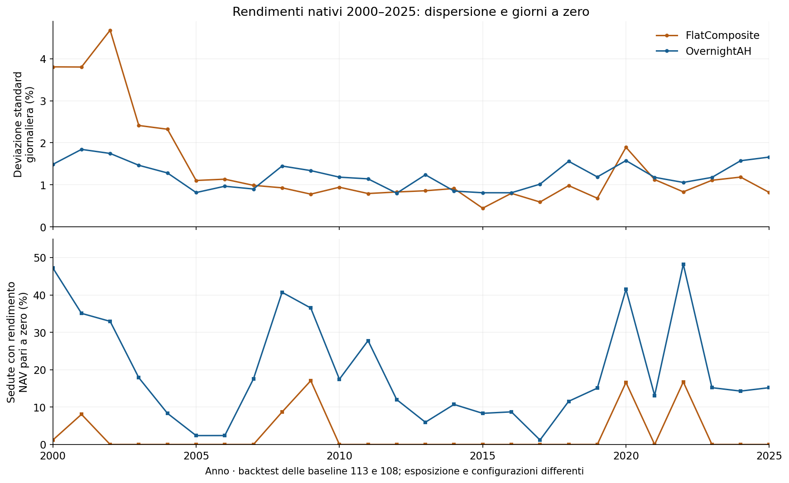
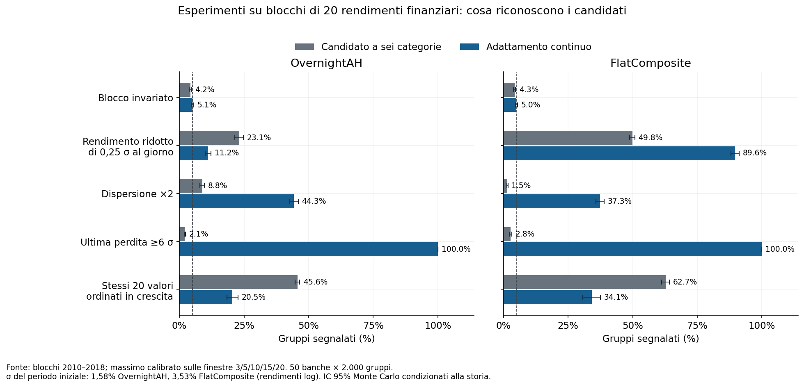
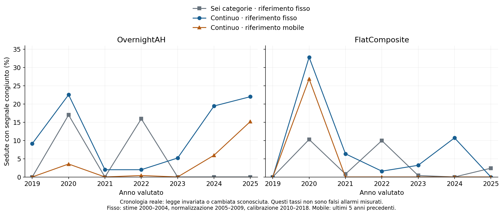

# Lo studio si adatta alla strategia?

24 ottobre 2026. **Si può riusare l'architettura del confronto. Il candidato a sei
categorie non è adeguato come unica misura dei rendimenti finanziari.**
L'adattamento continuo conserva l'ampiezza delle perdite, ma non supera tutti i
criteri fissati: con dispersione raddoppiata riconosce il cambiamento nel
44,35% dei gruppi OvernightAH
e nel 37,34% dei gruppi
FlatComposite, sotto il criterio esplorativo del 50% per entrambi.
**Raccomandazione: riusare il confronto di sequenze, rivedere la statistica
finanziaria prima dell'applicazione. Nessuna modifica all'applicazione.**

## 1. Dati finanziari effettivamente usati

| Strategia | Baseline | Periodo | Sedute | Trade nel periodo |
| --- | --- | --- | --- | --- |
| OvernightAH | 113 | 2000-01-03 — 2025-12-31 | 6539 | 30525 |
| FlatComposite | 108 | 2000-01-03 — 2025-12-31 | 6539 | 115186 |

Fonti: returns.csv, trades.json e results.json nativi dei run Watchtower,
individuati con query in sola lettura. OvernightAH proviene dalla baseline del
profilo live: qui è il nome del profilo di un **backtest storico**, non una serie
di eseguiti Alpaca. FlatComposite è un controllo su una seconda strategia con
leva 2, mentre OvernightAH ha leva 1. Non si confronta la loro redditività per
decidere quale negoziare e non si presume che i parametri 2026 fossero noti nel 2000.

I rendimenti sorgente non hanno valori mancanti o date duplicate. Entrambi i run
includono una barra del **2 gennaio 2026**, successiva al termine dichiarato del
1 gennaio: esclusa dallo studio. Con tutte le barre sorgente, il rendimento
composto riconcilia col PnL monetario nativo; il rendimento dopo il taglio resta
separato in results/data_quality.json. Nessun nuovo backtest economico è stato
eseguito: si analizzano i risultati nativi congelati con i relativi hash.

I run dichiarano commissione alpaca, ma PnL e pnlcomm coincidono per tutti i
trade: commissioni registrate pari a zero. I rendimenti seguono la contabilità
di questi backtest; non certificano costi effettivi del broker.

## 2. La variabile finanziaria conta

La UI confronta la **media dei rendimenti dei singoli trade** e riduce l'errore
standard con la radice del numero di trade recenti. Nei dati qui analizzati ci
sono in media 5.80 trade per giornata attiva
OvernightAH e 18.09 per FlatComposite:
condividono giornata e condizioni di mercato, quindi il loro numero non fornisce
altrettante osservazioni temporali indipendenti.

Per la successione delle ultime N sedute la serie primaria qui scelta è il
**rendimento giornaliero del portafoglio**, con log(1+r) nel calcolo. Conserva
esposizione e giornate con NAV invariato. Il gain medio/trade rimane una misura
descrittiva distinta. Un eventuale indicatore dovrebbe chiamarsi compatibilità
della serie giornaliera del portafoglio, anziché probabilità del gain medio/trade.

Ho controllato anche il rapporto giornaliero PnL netto dei trade chiusi / loro
nozionale iniziale, conservando l'equivalente lordo della riconciliazione.
Quando non ci sono chiusure, quel rapporto è mancante; uno zero effettivo del NAV
resta invece zero. La correlazione fra questo rapporto e il rendimento NAV sulle
giornate attive è 0.9988 per AH
e 0.8722 per FlatComposite.
Le serie non sono state sostituite silenziosamente l'una con l'altra.

La dipendenza finanziaria riguarda anche l'ampiezza dei movimenti: nel 2000–2018
la correlazione fra |r| di giornate consecutive è circa 0,18 per AH e 0,34 per
FlatComposite; nel 2019–2025 circa 0,23 e 0,27. Sono descrizioni campionarie,
non stime complete della legge. Dispersione e giorni a zero cambiano nel tempo.

## 3. Trasferimento diretto e adattamento continuo

**Riusato:** blocchi consecutivi, separazione cronologica fra costruzione,
normalizzazione e calibrazione, rango conservativo, confronto congiunto delle
finestre 3/5/10/15/20, distinzione fra controlli singoli e ripetuti.

**C5-Q6:** trasferimento delle statistiche precedenti a sei fasce definite dai
quantili dei rendimenti iniziali. Riusa parole di lunghezza 1/2/3, ripetizioni a
distanza 1..10 e massima sequenza della stessa categoria. Usa i periodi temporali
qui fissati, anziché i conteggi 500/500 delle simulazioni R03.

**F1 continuo:** rendimento cumulato, energia quadratica, estremi, drawdown
interno, quota e massima sequenza di perdite, prodotti a ritardo dei rendimenti
centrati e delle ampiezze. Considera tutte le distanze osservabili nella finestra,
fino a 19 con 20 sedute: questo non assume memoria del processo limitata a 19.
Formula, componenti e scale sono fissate nel protocollo prima degli esperimenti;
non sono state ritoccate per far superare i criteri.

Si confrontano statistiche di interi blocchi con i blocchi storici. Il metodo
non stima la densità di tutte le sequenze finanziarie e non restituisce
P(strategia invariata | dati). Un numero finito di riassunti può non distinguere
leggi congiunte diverse. Anche i blocchi non sovrapposti possono essere dipendenti.

## 4. Esperimenti controllati sui blocchi reali

Stime iniziali 2000–2004; normalizzazione 2005–2009; distribuzione empirica dei
blocchi di 20 sedute del 2010–2018. Per strategia: 50 banche da 200 blocchi,
2.000 gruppi valutati per banca, campionando blocchi interi con reinserimento.
I metodi usano le stesse banche e gli stessi gruppi. Si applicano solo le
alterazioni dichiarate nel protocollo, senza nuove configurazioni di strategia.

**44,35% significa circa 44 gruppi segnalati ogni 100 gruppi di 20 sedute** sotto
quello specifico esperimento. Il caso invariato misura falsi allarmi rispetto
alla distribuzione empirica costruita, non rispetto a una legge futura verificata.

| Scenario | AH sei fasce | AH continuo | Flat sei fasce | Flat continuo |
| --- | --- | --- | --- | --- |
| Nessuna alterazione | 4,23% | 5,12% | 4,26% | 5,01% |
| Rendimento -0,25 σ/giorno | 23,10% | 11,16% | 49,84% | 89,58% |
| Rendimento -0,5 σ/giorno | 54,86% | 41,54% | 70,47% | 100,00% |
| Rendimento -1 σ/giorno | 98,90% | 98,04% | 99,75% | 100,00% |
| Dispersione ×1,5 | 9,76% | 21,07% | 3,36% | 18,40% |
| Dispersione ×2 | 8,80% | 44,35% | 1,51% | 37,34% |
| Ultima perdita almeno 3 σ | 2,07% | 43,41% | 2,77% | 100,00% |
| Ultima perdita almeno 6 σ | 2,07% | 100,00% | 2,77% | 100,00% |
| Stessi 20 valori, ordine casuale | 3,46% | 4,46% | 3,67% | 5,52% |
| Stessi valori, ordine invertito | 4,23% | 5,00% | 4,20% | 5,26% |
| Stessi valori, ordinati in crescita | 45,64% | 20,54% | 62,71% | 34,13% |

Percentuali del massimo congiunto sulle cinque finestre. σ è la deviazione
standard dei rendimenti log iniziali: 1.58% AH
e 3.53% FlatComposite. Quindi -0,25 σ significa
circa -0,40 e -0,88 punti percentuali di rendimento log ogni giorno: il secondo
è già un cambiamento economicamente grande. Dispersione ×2 moltiplica le distanze
dalla media iniziale; non è una strategia alternativa realmente eseguita.

**Difetto misurato delle sei fasce:** aumentare una perdita rimanendo nella stessa
fascia non cambia nessuna statistica categoriale. Nel controllo dedicato, il
punteggio cambia in zero casi per C5-Q6 e nel 100% per F1. È un controllo del
punteggio: il p-value può saturare al minimo della banca, senza acquistare
precisione infinita sulle code.

**Limite rimasto:** F1 migliora gli stress di ampiezza ma perde sensibilità ad
alcuni cambiamenti di ordine. Riordinando gli stessi valori, il segnale AH passa
dal 45,64% categoriale al
20,54% continuo.
La permutazione casuale produce circa gli stessi segnali del caso invariato:
non è dimostrata capacità generale di riconoscere la rimozione della dipendenza
finanziaria. Invertire una serie può essere indistinguibile per processi reversibili.

Gli IC nelle figure sono intervalli t fra 50 banche Monte Carlo sulla stessa
storia finita: non sono 50 storie finanziarie indipendenti. Un 100% osservato
in uno stress non dimostra probabilità teorica di riconoscimento pari a uno.

## 5. Le finestre richieste, OvernightAH continuo

| Scenario | 3 sedute | 5 sedute | 10 sedute | 15 sedute | 20 sedute | Congiunto |
| --- | --- | --- | --- | --- | --- | --- |
| Invariato empirico | 4,63% | 4,53% | 5,05% | 5,35% | 5,15% | 5,12% |
| Rendimento -0,25 σ/giorno | 5,61% | 12,66% | 15,38% | 13,80% | 11,64% | 11,16% |
| Dispersione ×2 | 26,33% | 30,69% | 37,62% | 42,74% | 43,64% | 44,35% |
| Stessi valori riordinati | 26,14% | 17,03% | 7,51% | 3,75% | 29,04% | 20,54% |

La colonna congiunta calibra una statistica diversa rispetto alle colonne
singole: non è il minimo dei p-value e non migliora necessariamente ogni potenza.
Le finestre brevi hanno pochi dati per riconoscere cambiamenti della dipendenza.

## 6. Cronologia reale fuori dal riferimento: 2019–2025

Per ogni osservazione si usano solo rendimenti precedenti. Nel confronto mobile,
il riferimento viene ricostruito a inizio anno sui cinque anni precedenti e poi
rimane fisso per quell'anno. Le due baseline rispondono a domande diverse:
compatibilità con la storia remota oppure con il comportamento più recente.

| Strategia | Anno | Sei fasce, fisso | Continuo, fisso | Continuo, mobile |
| --- | --- | --- | --- | --- |
| OvernightAH | 2019 | 0/252 · 0,00% | 23/252 · 9,13% | 0/252 · 0,00% |
| OvernightAH | 2020 | 43/253 · 17,00% | 57/253 · 22,53% | 9/253 · 3,56% |
| OvernightAH | 2021 | 0/252 · 0,00% | 5/252 · 1,98% | 0/252 · 0,00% |
| OvernightAH | 2022 | 40/251 · 15,94% | 5/251 · 1,99% | 1/251 · 0,40% |
| OvernightAH | 2023 | 0/250 · 0,00% | 13/250 · 5,20% | 0/250 · 0,00% |
| OvernightAH | 2024 | 0/252 · 0,00% | 49/252 · 19,44% | 15/252 · 5,95% |
| OvernightAH | 2025 | 0/250 · 0,00% | 55/250 · 22,00% | 38/250 · 15,20% |
| FlatComposite | 2019 | 0/252 · 0,00% | 0/252 · 0,00% | 0/252 · 0,00% |
| FlatComposite | 2020 | 26/253 · 10,28% | 83/253 · 32,81% | 68/253 · 26,88% |
| FlatComposite | 2021 | 2/252 · 0,79% | 16/252 · 6,35% | 0/252 · 0,00% |
| FlatComposite | 2022 | 25/251 · 9,96% | 4/251 · 1,59% | 0/251 · 0,00% |
| FlatComposite | 2023 | 1/250 · 0,40% | 8/250 · 3,20% | 0/250 · 0,00% |
| FlatComposite | 2024 | 0/252 · 0,00% | 27/252 · 10,71% | 0/252 · 0,00% |
| FlatComposite | 2025 | 6/250 · 2,40% | 0/250 · 0,00% | 0/250 · 0,00% |

Ogni cella è **sedute segnalate / sedute valutate**. Le finestre si sovrappongono:
55 giornate segnalate non sono 55 episodi indipendenti. Non conosciamo lo stato
vero del processo: queste percentuali non misurano falsi allarmi e non validano
da sole una soglia del 5%.

Per esempio, per OvernightAH nel 2025 il riferimento fisso segnala 55/250 sedute
e il mobile 38/250; per FlatComposite nel 2024 passa da 27/252 a 0/252.
Ridurre i segnali con una storia mobile non dimostra maggiore accuratezza:
potrebbe assorbire un deterioramento persistente. La baseline fa parte della
domanda statistica e va definita prima dell'applicazione.

Ho ricostruito anche il controllo UI con i trade chiusi nelle ultime N sedute
e riferimento precedente al 2019. Per AH nel 2025, finestra di 20 sedute,
segnala 106/250 giorni (42,40%); F1 sulla sola finestra di 20 ne segnala
63/250 (25,20%). La riduzione non dimostra maggiore accuratezza: unità e domande
dei due test sono diverse.

## 7. Monitoraggio ripetuto e informazione disponibile

Nel 2010–2018 si ottengono 113 blocchi non sovrapposti di 20 sedute. Rango minimo
1/114, circa 0,88%; indipendenza e affidabilità sulle code non sono garantite.
Per il massimo entro 20 controlli quotidiani, con le separazioni fissate nel
protocollo, restano 38 periodi: minimo 1/39 = 2,56%. Per 100 controlli restano
16 periodi: minimo 1/17 = 5,88%. **Questa banca non permette una soglia del 5%
per l'intero periodo di 100 controlli.** Duplicare gli stessi periodi non aggiunge
informazione storica. Lo zero allarmi nei risultati non stimabili non è prova
di buona calibrazione. Nessuna garanzia perpetua o rinnovo automatico è dimostrato.

## 8. Decisione

**Adattabilità parziale, applicazione non pronta.** Il precedente esito positivo
sui dadi non si trasferisce ai ritorni. Il criterio sulla dispersione non è
passato per nessuna delle due strategie. Si conserva la struttura del confronto;
va sostituita la rappresentazione solo categoriale e va migliorata la sensibilità
finanziaria congiunta senza perdere quella all'ordine.

Prima di applicare: definire serie monitorata (qui NAV giornaliero), baseline e
orizzonte dei controlli; rivedere la statistica per piccoli cambiamenti e
volatilità; verificare su nuove osservazioni o scenari finanziari dipendenti
separati dallo sviluppo. Un allarme resta una segnalazione di anomalia: non
attribuisce automaticamente la causa a regime, perdita di edge, esposizione,
selezione, dati o costi. Il gain medio/trade può restare una misura descrittiva.

## Riproducibilità

Protocollo, sorgenti, hash, semi, indici del ricampionamento, percorsi alterati,
punteggi e conteggi sono conservati. La verifica indipendente ricostruisce gli
aggregati dei 145.780 trade sorgente, le componenti scalari e l'intera
normalizzazione su entrambe le strategie. Controlla 288 celle di rango campionate,
date reali campionate e l'aritmetica di tutte le 13.200 righe controllate.
Verifica calcolo e tracciabilità, senza dimostrare stazionarietà finanziaria.
Il notebook eseguito conserva tre figure e tabelle. Le revisioni precedenti sono
verificate inalterate. Riferimenti metodologici in [sources.md](sources.md).
